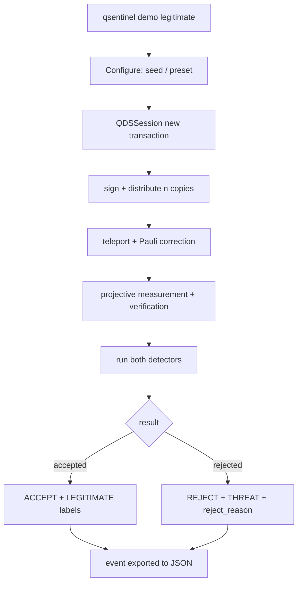
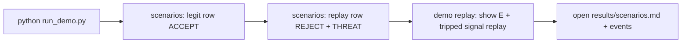
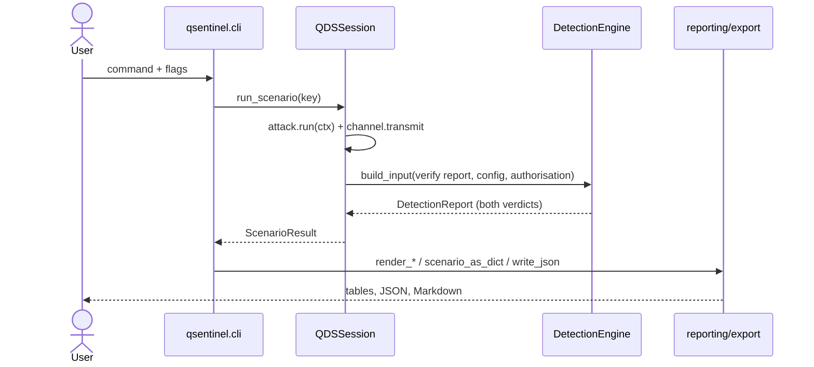
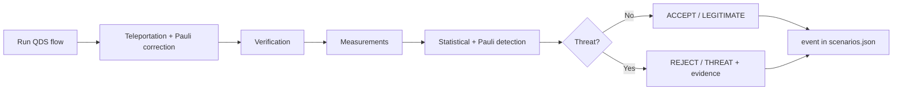

# Interface & Frontend Specification

**Smart India Hackathon 2026 — SIH26141** · **Egreen Quanta LLP** · **Category: Software · Theme: Security**
**Project:** *Quantum-Inspired Cyber Threat Detection for Digital Signature Security*
**Document Type:** Frontend / Interface Specification · Status: Prototype Documentation · Version: 1.0

> **Scope statement (important).** QuantumSigGuard's **primary** interface is the **terminal**
> provided by `qsentinel/cli.py` plus the **reporting/export layer** (`qsentinel/reporting/`) that
> renders results as ANSI console output, JSON and Markdown. An **optional local web viewer**
> (`streamlit run streamlit_app.py`, under the `[web]` extra) mirrors those results as a read-only
> dashboard — it is a pure view layer over the same engine and adds no detection logic (§18.7, §21).
> There is no REST API, no deployed URL, no SPA framework and no browser-side state. This document
> therefore specifies the interface that **actually exists**, and marks every browser/design-system/API
> item from a conventional "Frontend Specification" as **not implemented / future roadmap** rather
> than inventing a stack.
>
> The SIH evaluator experience is a **three-minute terminal demo** (§2.3, §4.3) — the export layer
> provides the evidence artifacts (`results/*.json`, `results/*.md`), and the optional dashboard is
> a convenience viewer, not a required path.

---

# 1. Overview & Scope

## 1.1 Purpose

The interface makes the full workflow operable and readable without a browser:

```text
Create QDS Session (QDSSession)
      ↓
Generate / Simulate Signature (sender sign)
      ↓
Optional Attack Injection (attacks registry)
      ↓
Verify Signature (verifier.verify)
      ↓
Analyze Quantum Measurements (verification checks + measurement_summary)
      ↓
Apply Statistical / Threshold Detection (two detectors)
      ↓
Classify Verification Result (DetectionEngine)
      ↓
Inspect Security Metrics and Logs (render_*  +  JSON/Markdown export)
```

Every screen-equivalent below is a rendered console view or exported artifact whose content comes
**only** from computed results — the interface never invents or alters a detection decision
(§18.7).

## 1.2 Interface Capability Register (actual status)

| Capability | Where it lives | Status |
|---|---|---|
| QDS overview "dashboard" | `evaluate` + `scenarios` console output | **Implemented** (console) |
| Teleportation-based QDS simulation | `qsentinel-cli demo`, `run_demo.py` | **Implemented** |
| Signature generation | protocol sender, shown in `render_scenario` | **Implemented** |
| Signature verification | `render_scenario` "Verification" block | **Implemented** |
| Attack simulation | `demo <attack>` / `scenarios` / `evaluate` | **Implemented** |
| Statistical threat detection | statistical signal table | **Implemented** |
| Quantum-inspired (Pauli) detection | Pauli signal table + measurement summary | **Implemented** |
| Experiment comparison | `render_comparison` method table | **Implemented** |
| Security-event logging | `results/scenarios.json`, event export | **Implemented** |
| Export / report view | `--output` JSON, `scenarios.md`, `generate_report.py` | **Implemented** |
| Web dashboard (view) | `streamlit run streamlit_app.py` (optional `[web]` extra) | **Implemented** (read-only, local) |
| Web dashboard / SPA | — | **Not implemented — future roadmap (§21)** |
| REST API | — | **Not implemented** |
| Real quantum hardware view | — | Out of scope (§21) |
| AI/ML detection | — | **Explicitly excluded** |

## 1.3 Assumptions (verified, not TBD)

| Item | Verified status |
|---|---|
| Python-based QDS prototype | **Implemented** (`qsentinel/`) |
| Teleportation-based QDS simulation | **Implemented** (`protocol/teleportation.py`) |
| Attack simulation (5 classes + benign) | **Implemented** (`attacks/`) |
| Statistical + Pauli-measurement detection | **Implemented** (`detection/`) |
| AI/ML | **Not used** |
| Real quantum hardware | **Not claimed** |
| Web frontend framework | **Streamlit viewer** (optional `[web]` extra, read-only, local) |
| REST API paths | **None exist** (CLI contract instead, §10) |
| Authentication | **None needed** (local single-user CLI; dashboard is localhost-only) |
| Hosting URL | **None** (local process) |

### Stack Register (actual)

| Area | Actual implementation |
|---|---|
| Interface shell | `qsentinel/cli.py` (`argparse`), console scripts `qsentinel-demo`, `python3 -m qsentinel.cli` |
| Language | Python 3.10+ (verified on 3.14.7) |
| "Styling" | ANSI color helpers — `qsentinel/reporting/console.py` (`NO_COLOR`/`FORCE_COLOR` aware) |
| Visualization | alignment-safe console tables + filled bars + Markdown tables (`reporting/`) |
| State management | `QDSSession` (replay cache, authorisation set, transaction counter) — not a browser store |
| API communication | none — direct in-process calls |
| Export | JSON (`export.write_json`) + Markdown (`scenario_to_markdown`, `generate_report.py`) |
| Hosting | local terminal only |

**No new library was (or should be) introduced to satisfy this document.**

---

# 2. Users, Personas & Key Use Cases (CLI-anchored)

## 2.1 Primary Personas

### Security Analyst

- Run verification: `qsentinel-demo demo legitimate` vs `demo replay` — read the `E` mismatch rate
  and the tripped signals.
- Inspect *why* a run flagged: each detector prints a **signal/value/rule/threshold/state** table
  (`render_scenario`).
- Compare runs: `qsentinel-demo scenarios` — side-by-side **truth / statistical / pauli /
  protocol / E** table (`render_comparison`).

### Researcher / Technical Evaluator

- Configure: `--seed`, `--preset` (`clean`, `noisy`, `degraded`, `unamplified`), `--trials`.
- Measure detector behaviour: `evaluate`, `noise-sweep`, `group-sweep` with `--output` JSON.
- Read exact measurement statistics: per-basis `measurement_summary` (copies, expected/observed +1,
  distribution distance, parity agreement) in `render_scenario`.

### SIH Judge / Demo Viewer

- Three-minute path (see §2.3): one legit run → one attacked run → comparison + event evidence.
- Read values, not jargon: verdict labels are **ACCEPT / REJECT / THREAT / LEGITIMATE** in text,
  never bare numbers or colors alone (§14.2).

### Administrator

**Not implemented** — single-operator local tool; no accounts. Becomes relevant only if a web
service is added (§21).

## 2.2 Persona User Stories (mapped)

- *As a security analyst I want to inspect measurement deviations so I understand why a run was
  flagged.* → `demo <attack>` prints value-vs-threshold per signal and the per-basis summary.
- *As a researcher I want a reproducible experiment.* → a single `--seed` parameterizes every run;
  `results/config.json` records it.
- *As a judge I want legit-vs-attacked side-by-side.* → `scenarios` comparison table.

---

# 3. Information Architecture

## 3.1 Command Tree (the "sitemap")

```text
qsentinel (prog; --version prints 1.0.0)
│
├── scenarios  [--seed N] [--preset NAME] [--json]
│      run all six scenarios once; comparison table (or JSON)
│
├── demo  [scenario]  [--seed N] [--preset NAME]
│      full per-transaction report; default steps through all six
│
├── evaluate  [--trials N] [--seed N] [--preset NAME] [--output PATH]
│      confusion-matrix metrics over N trials per attack
│
├── noise-sweep  [--rates "a b c ..."] [--trials N] [--seed] [--preset] [--output]
│      detection vs channel decoherence
│
└── group-sweep  [--sizes "g1 g2 ..."] [--trials N] [--seed] [--preset] [--output]
       detection vs distillation group size
```

## 3.2 Export Artifacts ("screens" stored on disk)

```text
results/
├── config.json        # full configuration incl. seed (reproducibility record)
├── scenarios.json     # per-scenario security-event records (see §5.2)
├── scenarios.md       # self-contained Markdown report of all six scenarios
├── evaluation.json    # metrics + per-attack table + runtime
├── noise_sweep.json   # detection/FAR vs decoherence
└── group_sweep.json   # detection/FAR vs parity group size
```

## 3.3 Route Table

**Not applicable** — there are no HTTP routes. The equivalent is the command table in §3.1 and the
export artifacts in §3.2.

---

# 4. User Flows

## 4.1 Standard Verification Flow



## 4.2 Attack Simulation Flow

```mermaid
flowchart TD
    A[qsentinel demo forgery | replay | ...] --> B[attack selected from registry]
    B --> C[AttackContext built: txn, rng, cache, authorisation]
    C --> D[attack.run -> AttackOutcome]
    D --> E[channel.transmit with outcome.disturbances]
    E --> F[verify + detect]
    F --> G[detection result table]
    G --> H[compare against legitimate baseline]
    H --> I[security event stored]
```

## 4.3 Judge Demo Flow (three minutes)



---

# 5. Screen-by-Screen Specification (console views)

## 5.1 "Dashboard" — `scenarios` comparison table + `evaluate` summary

**Purpose:** high-level overview without low-level detail.

Real output (`render_comparison`, seed = run at report generation):

```text
Method comparison
-------------------------
scenario        truth  statistical  pauli       protocol  E
-------------  ------  -----------  ----------  --------  ------
legitimate     legit   LEGITIMATE   LEGITIMATE  ACCEPT    0.0000
forgery        attack  THREAT       THREAT      REJECT    0.1562
impersonation  attack  THREAT       THREAT      REJECT    ...
replay         attack  THREAT       LEGITIMATE  REJECT    0.0000
```

`evaluate` adds the aggregate "metric cards": per-detector **detection rate (95% CI),
false-alarm rate (95% CI), accuracy**, a filled status bar, per-attack counts and mean runtime.

## 5.2 QDS Simulation "screen" — `qsentinel-demo demo [scenario]`

Full per-transaction report (`render_scenario`). Genuine excerpt (forgery run, seed default):

```text
Scenario: Signature forgery  [forgery]
  Adversarial action: Guessed 4/8 key bits correctly. ...
  Ground truth: ATTACK   quantum-visible: True

  Protocol data
    transaction 55fcfbb22e008524  nonce 212124108139  message 00110001  length 8
    requester 'alice'  authorised: True
    basis pattern ZXZXZXXZ  (key redacted; target eigenvalues +--++---)

  Distribution
    32 teleportation copies  8 witness pairs  0 dropped  0 classical messages tampered
    residual Pauli errors: I=32

  Verification
    signature valid: THREAT    freshness: LEGITIMATE    authorisation: LEGITIMATE
  check family  checks  failed  pass rate
  ------------  ------  ------  ---------
  single            32       7      78.1%
  parity            16       7      56.2%
  witness            8       0     100.0%
```

Per-basis measurement chart-equivalent:

```text
basis  copies  expected +1  observed +1  distance  parity
-----  ------  -----------  -----------  --------  ------
X         16        50.0%        37.5%    0.1250   0.750
```

No fabricated fidelity or security percentages are shown — only computed values (runtime,
mismatch rate, distances, parities).

## 5.3 Attack Simulation "screen" — `demo <attack>` / `scenarios`

For each attack, the report shows: adversarial action notes, ground truth, `expected_quantum_visible`,
distribution disturbances, reject reason and detection evidence. The five attack keys:
`forgery`, `impersonation`, `replay`, `unauthorized_verification`, `channel_manipulation`.
`channel_manipulation` additionally enumerates its four disturbance channels (§`docs/attacks.md`).

## 5.4 Verification Analysis — same `render_scenario` "Verification" block

Shows `signature valid / freshness / authorisation`, the check-family table, overall
`E = mismatch/total`, and `reject_reason`. The decision is text:
`THREAT`/`LEGITIMATE` (statistical and Pauli layers) plus `ACCEPT`/`REJECT` (protocol outcome) —
readable in under one second.

## 5.5 Threat Analysis — detector evidence tables

Two tables, **Method 1: statistical** and **Method 2: Pauli measurement**, each row:

```text
signal          value   rule  threshold  state
mismatch_rate   0.2000  >     0.0500     TRIPPED
replay          1.0000  >     0.0000     TRIPPED
...

basis_distribution_distance_Z   0.5000  >  0.2000  TRIPPED
parity_agreement_X              0.4375  <  0.9000  TRIPPED
entanglement_witness            1.0000  <  0.9000  ok
```

## 5.6 Experiment History — `evaluate --output evaluation.json`

Machine-readable per-attack table (attack, trials, statistical_detected, pauli_detected,
protocol_rejected, mean E) plus aggregate matrices — the durable record of past runs.

## 5.7 Security Event Log — `results/scenarios.json`

Each event (per scenario) records: `scenario`, `title`, `is_attack`, `notes`,
`expected_quantum_visible`, `accepted_by_protocol`, `elapsed_seconds`, `comparison`
(statistical/pauli/agree), the full `verification` block (signature_valid, freshness_ok,
authorisation_ok, reject_reason, mismatch_count, check_count, mismatch_rate, failing_checks), and
`detection_measures` (every signal name/value/threshold/comparison/tripped).

## 5.8 About / System — `README.md` and command `--version`

Contains SIH26141, organization, project title, scope, no-AI/ML statement, simulated-only status,
attack list and limitations.

---

# 6. Component Library (console "components")

| Component | Real implementation | Renders |
|---|---|---|
| `heading(text)` | `reporting/console.py:55` | bold underlined section title |
| `rule()` | `console.py:60` | 78-char rule |
| `table(headers, rows, aligns)` | `console.py:65` | alignment-safe fixed-width table; returns `(no rows)` when empty |
| `verdict_label(b)` | `console.py:96` | `THREAT` / `LEGITIMATE` (text label; color optional) |
| `bar(fraction, width)` | `console.py:103` | `####....` filled bar (status visualization) |
| `colour(text, style)` | `console.py:42` | ANSI style; disabled unless tty / `NO_COLOR` |
| `terminal_width()` | `console.py:110` | responsive-ish column sizing |
| `render_scenario / render_comparison / render_evaluation` | `reporting/render.py` | page-level views |
| `scenario_as_dict / scenario_to_markdown / write_json` | `reporting/export.py` | JSON/Markdown exports |

There is **no DOM/component framework**; these functions are the "component library", kept free of
business logic (`console.py` module docstring).

---

# 7. Design System

## 7.1 Semantics (ANSI colors actually used)

| Semantic | Style token | Used for |
|---|---|---|
| threat | red | tripped signals, THREAT, REJECT |
| legitimate | green | ok signals, LEGITIMATE, ACCEPT |
| warn | yellow | reject_reason, DISAGREE |
| info | blue | protocol/distribution headings |
| accent | magenta | detector headings |
| muted | dim | rules, summary labels |

Color is **decorative**: every meaning is carried by text (`THREAT`, `TRIPPED`, `ok`,
`REJECT`, `ACCEPT`) as well (§14.2). `NO_COLOR` strips ANSI codes entirely.

## 7.2 Typography & Layout

Terminal monospace; headings bold; numeric columns right-aligned; "responsive" via
`terminal_width()` (best-effort). The optional Streamlit dashboard (§21.3) carries full CSS/design
tokens in `ui/theme.py` / `.streamlit/config.toml` (dark-first palette, Inter + JetBrains Mono,
WCAG AA contrast on the token pairs) — the console colors above map 1:1 onto those tokens.

## 7.3 Motion

**None** — console output is static text. Accessibility requirement
(`prefers-reduced-motion`) is trivially satisfied (§14).

---

# 8. Data Visualization Specification

Everything shown is a **table, count, or filled bar** — the correct visualization for discrete
measurement outcomes, and the export layer reuses the same primitives.

| Concept | Realization | Real function |
|---|---|---|
| Measurement distribution | per-basis table: expected vs observed +1 fraction, distance, parity | `render_scenario` (uses `measurement_summary`) |
| Detection threshold plot | signal table: `value  rule  threshold  state` | `render_scenario` detector blocks |
| Legit vs attacked | comparison table: `truth statistical pauli protocol E` | `render_comparison` |
| Metrics | detection/FAR/accuracy with 95% CIs + filled `bar()` | `render_evaluation` |
| Timeline/event log | structured JSON event records | `scenario_as_dict` |
| Protocol flow | documented stages (`docs/math.md`) — never implies real hardware | doc text |

JSON data shapes (canonical, machine-readable) — e.g. detector measure:

```json
{
  "name": "mismatch_rate",
  "value": 0.0,
  "threshold": 0.05,
  "comparison": ">",
  "tripped": false
}
```

evaluation summary shape includes per-detector `detection_rate`, `false_alarm_rate`, `accuracy`
and `*_ci95` arrays plus `per_attack` rows and `mean_runtime_seconds`.

---

# 9. State Management & Data Flow

## 9.1 Persistent ("shared") state — `QDSSession`

| State | Owner | Purpose |
|---|---|---|
| `replay_cache` | session | freshness across transactions (§`protocol/freshness.py`) |
| `authorised_entities` | session | verification authorization set |
| `_accepted` history | session | record of accepted transactions (used by replay/eval seeding) |
| `_counter` | session | per-transaction RNG seed offset |
| `config` | session | immutable `ExperimentConfig` |

## 9.2 Flow (no asynchronous machinery)



No Redux/Zustand/Context equivalents exist or are needed — the session is the store.

---

# 10. Interface Contract (CLI, not REST)

## 10.1 Command Contract

| Command | Purpose | Flags | Output | Exit/Error |
|---|---|---|---|---|
| `scenarios` | all six scenarios once | `--seed`, `--preset`, `--json` | comparison table or JSON array | 0; `SystemExit("error: ...")` on bad input |
| `demo [scenario]` | full per-run report | `--seed`, `--preset` | rendered scenario report(s) | 0; `KeyError` on unknown scenario |
| `evaluate` | metrics over N trials/attack | `--trials` (1..10000), `--seed`, `--preset`, `--output PATH` | printed summary or JSON file | 0 |
| `noise-sweep` | detection vs decoherence | `--rates`, `--trials`, `--seed`, `--preset`, `--output` | sweep table or JSON | 0 |
| `group-sweep` | detection vs group size | `--sizes` (positive ints), `--trials`, `--seed`, `--preset`, `--output` | sweep table or JSON | 0 |
| `--version` | version | — | `1.0.0` | 0 |

## 10.2 Canonical JSON Contracts (what a future web layer would consume)

These are the *actual* export shapes (`ScenarioResult.as_dict`, `EvaluationResult.summary`,
`scenario_as_dict`), defined in the codebase:

```jsonc
// scenario event (results/scenarios.json)
{
  "scenario": "replay",
  "is_attack": true,
  "accepted_by_protocol": false,
  "comparison": { "statistical": true, "pauli_measurement": false, "agree": false },
  "verification": {
    "signature_valid": true, "freshness_ok": false, "authorisation_ok": true,
    "reject_reason": "nonce replay", "mismatch_count": 0, "check_count": 64,
    "mismatch_rate": 0.0, "failing_checks": []
  },
  "detection_measures": { "replay": {
    "name": "replay", "value": 1.0, "threshold": 0.0, "comparison": ">", "tripped": true } }
}
```

```jsonc
// evaluation summary (evaluate --output)
{
  "statistical": { "true_positives": 1000, "false_positives": 0,
                   "detection_rate": 1.0, "detection_rate_ci95": [0.9962, 1.0],
                   "false_alarm_rate": 0.0, "accuracy": 1.0, ... },
  "pauli_measurement": { "detection_rate": 0.6, "detection_rate_ci95": [0.5693, 0.6299], ... },
  "per_attack": [ { "attack": "legitimate", "is_attack": false, "trials": 200, ... }, ... ],
  "mean_runtime_seconds": 0.0111, "total_runtime_seconds": 13.32
}
```

TypeScript interfaces, pagination, timeouts, retries etc. are **future web-only concerns** and are
not invented here.

---

# 11. Handling Long-Running Computations

Simulations are **synchronous and fast** (measured, seed `20260101`, single-threaded):

| Workload | Measured wall time (this host) |
|---|---:|
| One transaction (any scenario) | ≈ 11 ms mean |
| `evaluate --trials 200` (1200 transactions) | ≈ 13.3 s |
| `generate_report.py` (full `results/` bundle, 200-trial evaluation) | ≈ 52 s |
| Test suite (`unittest discover`) | ≈ 4.4 s |

Best practice followed: no fake progress. Commands block and print final results. There is no
cancellation, no polling and no partial-result mode — none is needed at this scale. If a web
layer is added with large batch jobs, a job-ID/polling pattern would come first (roadmap §21).

---

# 12. Forms, Validation & Input Handling

All "forms" are CLI flags; every value is validated *twice* — at the CLI boundary and again in the
frozen config dataclasses (backend is authoritative):

| Field | Rule | Validator |
|---|---|---|
| `--seed` | positive int | `cli`/`config` |
| `--trials` | integer `1..10000` | `cli._parse_trials_safe` |
| `--rates` | comma/space floats | `cli._parse_float_list` |
| `--sizes` | positive integers | `cli.command_group_sweep` |
| `--preset` | one of `clean,noisy,degraded,unamplified` | argparse choices |
| message/config values | `[0,1]` ranges, positive counts, `group <= copies`, `sign_bit ∈ {0,1}` | `config.py __post_init__` ×3 |

Error messages are specific (e.g. `error: expected a positive integer, got 'x'`);
invalid scenarios raise `KeyError`; there is no dataset upload (§12.1).

## 12.1 Dataset Upload

**N/A** — no external dataset and no upload feature (SIH lists Public/Open data, but this
implementation generates its observations from the seeded protocol). A file uploader is **not**
added just to satisfy a "dataset" label.

---

# 13. Responsive Layout & Cross-Browser

**N/A** — there is no browser. The terminal renders alignment-safe fixed-width tables
(`console.table`), honors `terminal_width()`, and strips ANSI when piped. Desktop/laptop terminal is
the sole target; this matches the SIH demo format.

---

# 14. Accessibility & Internationalization

## 14.1 WCAG-relevant posture (console)

- **Status is never color-only**: `verdict_label()` and tables emit `THREAT`/`LEGITIMATE`,
  `TRIPPED`/`ok`, `ACCEPT`/`REJECT` as text; color is additive.
- Output degrades to plain text under `NO_COLOR` and when piped (``sys.stdout.isatty()``).
- No keyboard trap, no timed content, no flashing motion.
- Sample screen-reader-equivalent descriptions are trivially derived because all output is text.

## 14.2 Internationalization

**English only (implemented).** A future dashboard should add `en`/`hi` locales while keeping
technical identifiers untranslated (Pauli-X/Y/Z, Bell state, QDS). Not implemented today.

---

# 15. Performance Budget & Optimization

## 15.1 Measured targets (this host)

| Metric | Value |
|---|---:|
| Verification latency per transaction | ≈ 11.1 ms |
| Throughput (single-threaded) | ≈ 90 transactions/s |
| Full evaluation (1200 trials) | ≈ 13.3 s |
| Full report bundle | ≈ 52 s |
| Test suite | ≈ 4.4 s (73 tests) |

| Browser metric | Status |
|---|---|
| Initial page load / Lighthouse | **N/A — no web app** |

## 15.2 Real optimization strategy

- Registers ≤ 3 qubits (constant per-run simulation cost).
- Vectorized NumPy statistics.
- Independent experiments → batch/`multiprocessing` parallelism is the documented next step
  (currently single-threaded).

---

# 16. Security on the Interface Side

- **No browser, no client secrets**: there are no tokens, credentials or storage to protect
  (§`docs/security.md` — verified by repo scan).
- **The interface is not the decision-maker**: verdicts come from `DetectionEngine`; `render_*`
  and `export` only serialize existing `DetectionReport` signals. The integrity rule of §18.7 is
  therefore structural, not aspirational.
- Errors shown are the CLI's own messages; no Python tracebacks are rendered for normal users
  (argparse `SystemExit` prints a short message; `KeyboardInterrupt` exits with code 130).
- Simulation vs real-hardware terminology is strictly separated in every view (§8, §5.8).

---

# 17. Error Handling

| Error class | Behaviour |
|---|---|
| Bad flag / value | argparse/cli prints `error: <specific message>`, exit ≠ 0 |
| Invalid preset/scenario | argparse choices / `KeyError` (tested: `test_unknown_scenario_is_an_error`) |
| Config invariant violation | `ValueError` from `__post_init__` |
| Interrupt | `KeyboardInterrupt` → exit 130 |
| Uncaught exception | Python exception (local tool); never exposed through any network surface |

Logging: no third-party client analytics platform exists; application security events are computed
and exported by the backend (`results/scenarios.json`), never fabricated locally (§`docs/security.md`
§10.1).

---

# 18. Testing Strategy (implemented for the interface)

| Test file | Covers (interface-relevant) |
|---|---|
| `tests/test_cli.py` | `scenarios`, `demo <attack>`, `evaluate`, `noise-sweep` commands; `--version`; JSON round-trip; `write_json` pretty-print; `render_scenario` non-empty with THREAT; unknown-scenario error |

### Mapping of conventional FE cases

| ID | Scenario | Status in CLI world |
|---|---|---|
| FE-03 | Execute legitimate run | `demo legitimate` → ACCEPT shown (tested) |
| FE-04 | Execute an implemented attack | `demo forgery` → THREAT shown (tested) |
| FE-02/06 | Invalid input / backend error | `cli` validation + `KeyError` (tested) |
| FE-01 | Empty state | model: no prior runs → `scenarios` still renders all rows; N/A for dashboards |
| FE-10 | Threshold/value graph matches backend | signal tables read directly from `DetectionReport` signals — no client-side recalculation |

### 18.7 Integrity test (non-negotiable)

If the backend verdict is `"threatDetected": false`, the rendering **must not** display a threat.
Because `scenario_as_dict`/`render_scenario` consume `DetectionReport` booleans directly, the
interface cannot invert a verdict.

---

# 19. Build, Deployment & Environment Setup

## 19.1 Environment Variables

**None required.** No `.env`, no credentials, no client-side configuration. Runtime dependency:
NumPy only.

## 19.2 Run Instructions (real)

```bash
cd ~/Desktop/QuantumSentinel
python3 -m venv .venv && source .venv/bin/activate
pip install -r requirements.txt            # numpy>=1.24
pip install -e .                            # optional: installs qsentinel-demo

python3 -m qsentinel.cli scenarios          # or: qsentinel-demo scenarios
python3 -m qsentinel.cli demo forgery
python3 run_demo.py                         # printed walkthrough
python3 scripts/generate_report.py          # regenerates results/
python3 -m unittest discover -s tests       # 73 tests
```

## 19.3 Deployment Status (real)

| Item | Status |
|---|---|
| Local development | Implemented (CLI) |
| Public URL / cloud / Docker / CI | **Not present** (local tool; future roadmap) |
| HTTPS | N/A (no network surface) |

---

# 20. Project Structure (interface-relevant subset)

```text
QuantumSentinel/
│
├── qsentinel/
│   ├── cli.py                  # command surface (argparse)
│   ├── session.py              # orchestration + stateful store
│   ├── reporting/
│   │   ├── console.py          # tables, headings, colors, bars, verdict labels
│   │   ├── render.py           # render_scenario / render_comparison / render_evaluation
│   │   └── export.py           # write_json, scenario_as_dict, scenario_to_markdown
│   ├── detection/  evaluate/  attacks/  protocol/  quantum/   # compute layers
│   │
├── scripts/
│   ├── generate_report.py      # builds results/ bundle
│   ├── run_evaluation.py
│   └── benchmark.py
│
├── tests/test_cli.py           # interface tests
├── run_demo.py                 # narrative walkthrough
├── results/                    # scenarios.json/md, evaluation.json, sweeps, config.json
└── docs/
    ├── frontend.md             # this document
    ├── technical_architecture.md  security.md  architecture.md  math.md
    ├── attacks.md  detection.md  results.md  limitations.md  prd-traceability.md
```

Naming conventions: Python (snake_case modules/functions, PascalCase classes) — not JavaScript.
Quantum math stays out of presentation code (separation enforced by `reporting/` importing only
dataclasses).

---

# 21. Limitations & Future Frontend

## 21.1 Current Interface Limitations

- Primary interface is console + exports; the optional Streamlit dashboard (§21.3) is read-only and
  local, with no REST API or persistence of its own.
- No dedicated HLA/"verification UI" beyond console rendering; judge demo is terminal-based.
- Dashboard charts are coarse (bar/line only), no interactive threshold manipulation, no browser-side state.
- No multilingual (English-only), no graphical threshold plots beyond the dashboard's value bars.
- No large-batch long-running jobs (not needed at 90 tx/s).

## 21.2 Roadmap

**Phase 1 — SIH prototype (done):** CLI flows above, event export, judge demo path, optional
local web dashboard (§21.3).

**Phase 2 — web dashboard in a browser (partially built as the local viewer):** a lightweight
read-only UI over the existing JSON contracts (`evaluation summary`, `scenario event`,
`detection_measures`) — already started via `streamlit_app.py` + `app_pages/` + `ui/`. Remaining
roadmap items: interactive threshold plots (value-vs-threshold sliders), per-basis measurement
distribution bars, legit-vs-attacked comparison, WCAG AA tokens and `en`/`hi` locales if adopted;
a REST layer only if a service deployment is required. No fabrication of progress (real job
blocks/polls), no invention of security metrics.

**Phase 3 — scale (only if warranted):** bigger workloads (multiprocessing), richer attack models,
real-parameter batch jobs.

Throughout: the strict "no invented values, no real-quantum implication, no AI/ML, backend is
source of truth" rules of this document carry over unchanged.

## 21.3 Local Web Dashboard (implemented)

An **optional** Streamlit dashboard ships under the `[web]` extra. It is explicitly a **view layer**:

- `streamlit_app.py` — entry point, branded sidebar, global styling injection (`ui/theme.py`),
  footer; no state beyond Streamlit's own.
- `app_pages/overview.py` — KPIs, method comparison, per-attack counts, detection-rate bar chart
  and both robustness sweeps, all read from `results/*.json` (values are never recomputed or
  hard-coded; when the bundle is absent the page shows an empty state).
- `app_pages/scenario_lab.py` — runs one scenario live through the real engine
  (`QDSSession`, seeded), shows the classical protocol verdict, per-signal value-vs-threshold
  progress bars for both detectors, and the full failed-check list.
- `app_pages/evaluation.py` — live `run_evaluation` with chosen trials/seed and JSON/CSV export.
- `web_helpers.py` — pure reshaping/format helpers (DataFrames, CSV/JSON payloads); engine logic
  stays in `qsentinel/`.
- `ui/components.py` + `ui/theme.py` — design tokens (dark-first palette, Inter + JetBrains Mono),
  a matching Altair theme, and reusable components (hero, KPI cards, verdict badges, styled tables,
  empty states, callouts). `.streamlit/config.toml` defines both dark and light themes.

Design tokens (dark): bg `#0B1220`, surface `#111A2E`, accent cyan `#22D3EE`, violet `#8B5CF6`,
safe `#22C55E`, threat `#EF4444`, warning `#F59E0B`, info `#38BDF8`. Footers carry
`SIH 2026 · SIH26141 · Egreen Quanta LLP`.

---

# Final Interface Position

The QuantumSigGuard interface tells one story — printable on a terminal in three minutes:



The interface prioritizes **explainability over decoration**: for every transaction it shows not
only the verdict but the exact signal values, rules, thresholds and tripped states behind it, and
it persists that evidence as JSON/Markdown for judges and evaluators. That aligns with the SIH
requirement for a teleportation-based QDS framework incorporating signature verification, controlled
cyber-attack simulation, Pauli/projective measurement analysis, statistical threat identification,
security analysis, performance evaluation and security-event logging — **without AI/ML and without
claiming a web stack that does not exist.**