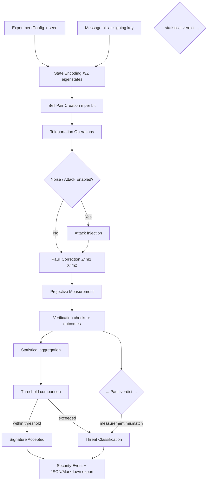
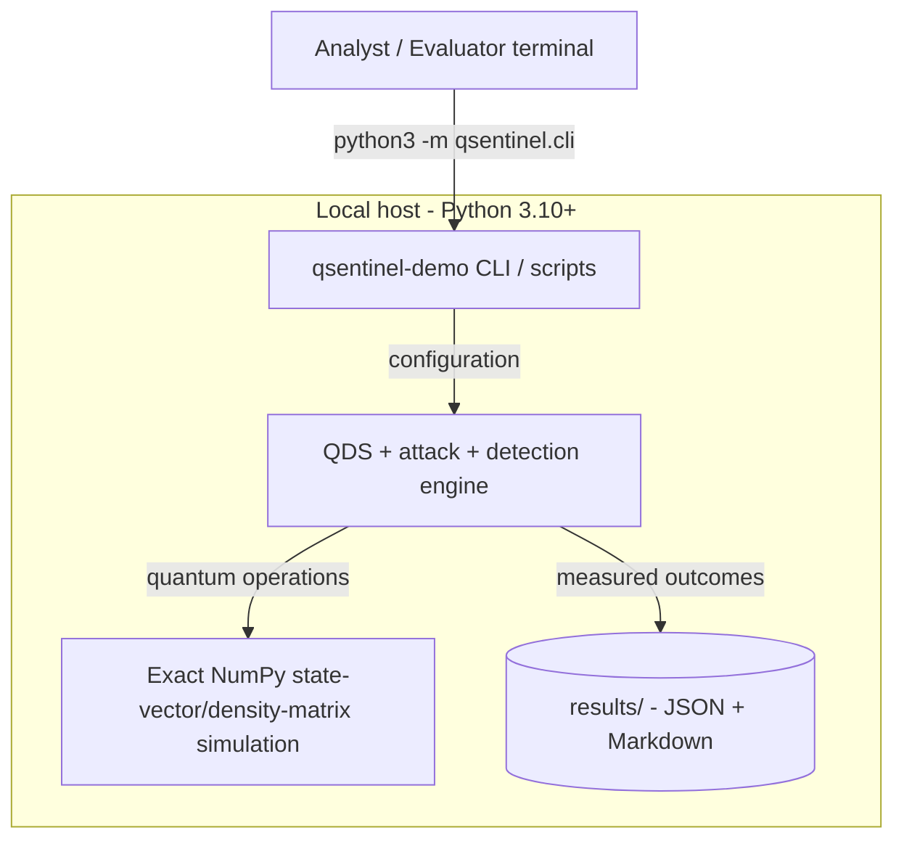
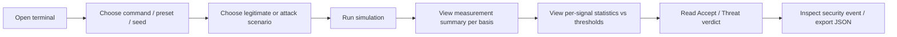

# Technical Architecture Document

## Smart India Hackathon 2026 — Problem Statement SIH26141

**Organization:** Egreen Quanta LLP
**Category:** Software
**Theme:** Security
**Selected Problem Statement:** **Quantum-Inspired Cyber Threat Detection for Digital Signature Security**

> This document describes the actual implemented prototype **QuantumSigGuard** in the repository
> `~/Desktop/QuantumSentinel`. Every value, threshold, metric and module name below is taken from
> the code (`qsentinel/config.py`, `qsentinel/detection/*`, `results/*.json`) and the measured
> experiment output, **not** from a template or from estimates. Anything that the project does *not*
> implement (web API, database, Docker, Qiskit, real quantum hardware) is stated explicitly as such.

---

# 1. Executive Summary

QuantumSigGuard is a **pure-Python, NumPy-only simulation of teleportation-based Quantum Digital
Signatures (QDS)** with a **two-layer, threshold-based threat-detection engine** that is explicitly
**not** AI/ML based, per the SIH26141 requirement.

The prototype implements:

- quantum state preparation (single-qubit eigenstates encoded by a signing key),
- Bell-pair entanglement (`|Φ(λ)> = (|00> + λ|11>) / √2`),
- quantum teleportation of a message qubit (CNOT, Hadamard, two classical measurement bits,
  Pauli correction `Z^m1 X^m2`),
- projective Pauli-measurement verification (per-copy, cat-state parity, entanglement witness),
- five attack classes (forgery, impersonation, replay, unauthorized verification,
  channel manipulation),
- **statistical threshold detection** (mismatch rate, QBER, per-basis QBER, coverage, replay,
  authorisation) and **Pauli-measurement detection** (eigenvalue agreement, per-basis outcome
  distributions, parity agreement, entanglement correlators),
- deterministic security-event conclusions that are fully traceable to measured statistics,
  thresholds and protocol rules,
- CLI, evaluation harness, JSON/Markdown reporting and a 73-test suite.

Detection is entirely explainable and deterministic: a fixed set of signals is compared against
fixed thresholds derived from the protocol's analytic behaviour; nothing is learned, fitted or
estimated from attack data.

**AI/ML usage: none. Real quantum hardware: none. Detected threats: 5 classes + benign baseline.**

---

# 2. Problem Analysis & Objectives

## 2.1 Problem Background

Conventional digital-signature schemes (RSA, ECC) rest on computational-hardness assumptions that
large-scale quantum computers threaten via algorithms such as Shor's. SIH26141 therefore targets
**Quantum Digital Signatures** — specifically a teleportation-based formulation using Bell-state
entanglement, quantum teleportation, Pauli corrections, projective measurements and statistical,
non-ML threat analysis.

QuantumSigGuard implements the *threat-detection and simulation* part of that system. It is a
research/demonstration framework, **not** a deployed quantum network.

## 2.2 Primary Pain Points

- Classical signature monitoring is not designed around quantum-state behaviour.
- Channel manipulation surfaces as abnormal *measurement statistics*, not packet-level indicators.
- QDS evaluation needs a reproducible environment for legitimate and malicious scenarios.
- Detection decisions must be explainable and deterministic.
- Real quantum hardware is expensive/inaccessible at scale — a simulation is the practical vehicle.
- SIH forbids ML detection, so decisions must derive from measurable protocol behaviour.

## 2.3 Target Users

- Cybersecurity and quantum-computing researchers.
- Digital-signature / security engineers.
- SIH evaluators running the prototype in CLI demonstration mode.

## 2.4 Core Objectives

The system shall:

- simulate a teleportation-based QDS workflow;
- establish Bell-state entanglement;
- perform simulated quantum teleportation with Pauli correction;
- perform projective measurements for verification;
- detect forgery, impersonation, replay, unauthorized verification and channel manipulation;
- compute measurement/mismatch statistics;
- classify threats by fixed thresholds;
- log security events; report verification and detection metrics;
- keep quantum simulation, statistical security analysis and CLI/reporting strictly separated.

## 2.5 Measurable Goals (measured values)

| Goal | Measurement |
|---|---|
| Legitimate signature acceptance rate | 100% (200/200, statistical & Pauli detectors) |
| Forgery detection rate | 100% (200/200, both detectors) |
| Impersonation detection rate | 100% (200/200, both detectors) |
| Replay detection rate | 100% statistical / 0% Pauli (quantum-invisible; see §10) |
| Unauthorized-verification detection rate | 100% statistical / 0% Pauli (quantum-invisible; see §10) |
| Channel-manipulation detection rate | 100% (200/200, both detectors) |
| False-positive rate | 0.0% (200 legitimate trials; 95% CI upper bound 1.9%) |
| Average verification latency | ≈ 11.1 ms per transaction (mean of 1200 trials) |
| Simulation throughput | ≈ 90 transactions/second (single-threaded) |
| Memory consumption | Not instrumented; state vectors are ≤ 3 qubits (≤ 64 complex amplitudes) |

All values: seed `20260101`, 200 trials per attack, 1200 total trials.

---

# 3. System Overview

The system is organized in six layers:

1. **Configuration** — `qsentinel/config.py` (protocol, channel, detection thresholds).
2. **Quantum core + QDS protocol simulation** — `qsentinel/quantum/`, `qsentinel/protocol/`.
3. **Attack simulation** — `qsentinel/attacks/` (registry + 5 attacks).
4. **Detection** — `qsentinel/detection/` (statistical + Pauli-measurement layers).
5. **Interface / orchestration** — `qsentinel/session.py`, `qsentinel/cli.py`, `scripts/`.
6. **Reporting & logging** — `qsentinel/reporting/`, `results/`.

There is **no web application, no REST API and no ML**. The application layer is a terminal CLI
(`qsentinel-demo` / `python -m qsentinel.cli`) plus three scripts (`scripts/run_evaluation.py`,
`scripts/generate_report.py`, `scripts/benchmark.py`).

## 3.1 High-Level Workflow

```text
Experiment Configuration
        ↓
Message / Signature Input
        ↓
Quantum State Preparation (X/Z eigenstates, key-dictated)
        ↓
Bell Pair Generation  |Φ(λ)>
        ↓
n copies teleported per message bit
        ↓
Optional Attack Injection (channel &/or signing stage)
        ↓
Pauli Correction  Z^m1 X^m2
        ↓
Projective Measurement (per-copy, parity, witness)
        ↓
Measurement Statistics (E, QBER, expectations, distributions)
        ↓
Threshold-Based Detection (two layers)
        ↓
Accept / Reject / Threat Classification
        ↓
Console render + JSON/Markdown export + security event log
```

## 3.2 Key Design Principles

- **Deterministic and explainable** — every verdict traces to specific signals, measured values,
  configured thresholds and the tripped rules (see `DetectionResult.summary`).
- **Modular** — quantum simulation, protocol, attacks, detection, evaluation, reporting and CLI are
  separate packages with narrow dataclass interfaces.
- **Reproducible** — a single top-level `seed` (`ExperimentConfig.seed`) drives all `numpy`
  randomness; experiments can be rerun exactly.
- **No AI/ML** — no neural networks, classifiers, clustering, LLMs or learned thresholds.
- **Simulation-first and honest** — the protocol is a classical exact state-vector/density-matrix
  simulation; the docs and README never claim real-QPU execution or physical security guarantees.

---

# 4. Architecture Diagram(s)

## 4.1 Overall System Architecture

```mermaid
flowchart LR

    U[User / Security Analyst]

    subgraph CONFIG["Configuration"]
        CFG[ExperimentConfig]
    end

    subgraph APP["Application Layer"]
        CLI[CLI / scripts]
        ORCH[QDSSession orchestrator]
    end

    subgraph QDS["QDS Protocol Engine"]
        PREP[State Preparation]
        BELL[Bell-State Generator |Φ>]
        TELE[Teleportation Simulator]
        PAULI[Pauli Correction Z^m1 X^m2]
        VERIFY[Projective Verification]
    end

    subgraph ATTACK["Attack Simulation Engine"]
        FORGE[Forgery]
        IMP[Impersonation]
        REPLAY[Replay]
        UNAUTH[Unauthorized Verification]
        CHANNEL[Channel Manipulation]
    end

    subgraph DET["Threat Detection Engine"]
        STATS[Statistical Layer]
        PAULIDET[Pauli-Measurement Layer]
        DECISION[Decision Engine]
    end

    subgraph DATA["Data & Reporting"]
        RESULTS[(results/ JSON + Markdown)]
    end

    U -->|run command| CLI
    CLI -->|config| CFG
    CLI -->|start experiment| ORCH

    ORCH -->|prepare state| PREP
    PREP -->|qubits| BELL
    BELL -->|entangled qubits| TELE

    ORCH -->|attack configuration| ATTACK
    ATTACK -->|modified channel / signing| TELE

    TELE -->|measurement bits| PAULI
    PAULI -->|corrected state| VERIFY
    VERIFY -->|checks + outcomes| STATS
    VERIFY -->|measurement outcomes| PAULIDET

    STATS -->|signals| DECISION
    PAULIDET -->|signals| DECISION

    DECISION -->|verdict| ORCH
    ORCH -->|reports| RESULTS
```

## 4.2 Data Flow Diagram



## 4.3 Deployment

The prototype runs as a **local Python application**; there is no server, no browser UI and no
container. The recommended interface is the console entry point.



**Deployment position:** simulator-only. No real QPU execution occurs or is implied.

---

# 5. Component Design

## 5.1 Experiment Configuration Module — `qsentinel/config.py`

Single source of truth for all tunables (`ProtocolConfig`, `ChannelConfig`, `DetectionConfig`,
`ExperimentConfig`, `PRESETS`).

```json
{
  "message": "example (8 bits)",
  "attack_type": "forgery | impersonation | replay | unauthorized_verification | channel_manipulation",
  "copies_per_bit": 4,
  "thresholds": "see §5.5 / §6.9",
  "seed": 20260101
}
```

Output: a frozen `ExperimentConfig` dataclass that flows to every layer.

## 5.2 Preprocessing / State-Encoding Module — `qsentinel/protocol/sender.py`, `state.py`

No ML preprocessing. Responsibilities:

- validate the message length and protocol parameters (`ProtocolConfig.__post_init__`);
- encode message bits into key-dictated `X`/`Z` eigenstates (values `v_i = m_i XOR k_i`,
  `λ = (-1)^sign_bit`);
- allocate per-bit teleportation copies and retained witness pairs;
- instantiate seeded RNG streams via `ExperimentConfig.rng(offset)`.

Outputs: the distributed copyset (`quantum/` object graph) and a `Transaction` used as the
verifier's expectation record.

## 5.3 Core QDS Protocol Engine — `qsentinel/quantum/`, `qsentinel/protocol/`

Implements the full SIH-required workflow:

| Module | Responsibility |
|---|---|
| `quantum/statevector.py` | exact complex state vectors; `reduced_single_qubit` (dominant eigenvector) |
| `quantum/gates.py` | identity, `X`, `Z`, `H`, `CNOT`-style coupling |
| `quantum/states.py` | Pauli eigenstates, `|Φ(λ)>` Bell resource |
| `quantum/measurement.py` | projective outcomes with Born sampling, Pauli expectations, `ParityOutcome`, `parity_measurement` |
| `protocol/teleportation.py` | 3-qubit estimation circuit → measurement bits `m1, m2`; correction `Z^m1 X^m2`; fidelity check |
| `protocol/sender.py` | message/key encoding + signing |
| `protocol/state.py` | distributed copies, transactions, `VerificationReport` (`all_checks`, `parity_outcomes`, `mismatch_count`) |
| `protocol/verifier.py` | per-copy, coverage, cat-state parity, witness and authorisation checks; `Verifier` with nonce/freshness cache |
| `protocol/freshness.py` | deterministic nonce + replay cache |

Inputs: encoded state, signature/key, simulator settings.
Outputs: corrected states, measurement results, full `VerificationReport`.

## 5.4 Channel Simulation — `qsentinel/channel.py`

`QuantumChannel` applies a physical noise model (decoherence as a Pauli channel, classical-bit
tampering, loss as maximally-mixed replacement) plus the attack hooks, and returns the received
copyset plus context notes for the detection layer.

## 5.5 Attack Simulation Engine — `qsentinel/attacks/`

| Threat | Module | Simulation concept |
|---|---|---|
| Forgery | `forgery.py` | adversary signs the message with a guessed key that matches the real key on `guess_accuracy = 0.5` of positions; wrong guesses are eigenstates of the wrong Pauli operator |
| Impersonation | `impersonation.py` | adversary submits a *well-formed* signature (their own key) and relabels the sender identity; mismatch concentrates on positions where their key differs from the verifier's |
| Replay | `replay.py` | previous nonce/session re-submitted to the verifier |
| Unauthorized verification | `unauthorized.py` | verification requested by a non-authorised entity |
| Channel manipulation | `channel_manipulation.py` | Pauli errors injected on transmitted copies, forged classical teleportation bits (wrong Pauli correction), dropped copies (photon loss), and disturbance of retained witness pairs |

Attacks are composable with the physical noise model (both can act in one transaction). A benign
baseline (`attacks/__init__.py`) passes through untouched.

## 5.6 Detection Engine — `qsentinel/detection/`

Two fixed-rule detectors over the same `DetectionInput`.

**Method 1 — `StatisticalDetector` (`statistical.py`)**. Threshold rule set over:

| Signal | Meaning | Threshold |
|---|---|---|
| `mismatch_rate` | `E = N_mismatch / N` over all checks | `> 0.05` |
| `qber` | per-copy error rate | `> 0.02` |
| `per_basis_qber_X` / `per_basis_qber_Z` | per-copy error rate per basis | `> 0.05` |
| `coverage_shortfall` | fraction of expected copies never returned | `> 0.0` |
| `replay` | nonce already accepted | `> 0.0` |
| `authorisation` | verifier not authorised for this entity | `> 0.0` |

**Method 2 — `PauliMeasurementDetector` (`pauli.py`)**. Quantum-measurement rule set, deliberately
blind to protocol context:

| Signal (per `X`,`Z`) | Meaning | Threshold |
|---|---|---|
| `eigenvalue_agreement_<basis>` | mean Pauli expectation of copies intended `+1` | `< 0.90` |
| `basis_distribution_distance_<basis>` | TV distance observed vs expected outcome histogram | `> 0.20` |
| `parity_agreement_<basis>` | fraction of cat-state parities matching intended value | `< 0.90` |
| `entanglement_witness` | fraction of retained Bell pairs matching ideal correlators | `< 0.90` |

`DetectionEngine` runs both, pairs the verdicts in a `DetectionReport`, and `DetectionReport.as_dict`
provides the JSON export. Alarm = **any** tripped rule.

## 5.7 Interface / Application Layer — `qsentinel/cli.py`, `session.py`

There is **no REST API and no web UI**. The application surface is a terminal CLI:

| Command | Purpose |
|---|---|
| `qsentinel scenarios [--seed] [--preset] [--json]` | run all six scenarios once, compare in a table or JSON |
| `qsentinel demo [scenario]` | run one scenario in full detail (or step through all) |
| `qsentinel evaluate [--trials N] [--seed] [--preset] [--output PATH]` | controlled experiment with confusion-matrix metrics |
| `qsentinel noise-sweep [--rates ...] [--trials N] [--output PATH]` | detector behaviour vs channel decoherence |
| `qsentinel group-sweep [--sizes ...] [--trials N] [--output PATH]` | detector behaviour vs distillation group size |
| `qsentinel --version` | print version (`1.0.0`) |

Entry points: `python -m qsentinel.cli`, the installed console script `qsentinel-demo`, and
`python run_demo.py` (example walkthrough), plus `scripts/*.py` (evaluation, report generation,
benchmark).

`QDSSession` (`session.py`) orchestrates sender → channel → verifier → detection per scenario and
carries the per-transaction event log.

## 5.8 Reporting & Security Event Log — `qsentinel/reporting/`, `results/`

| Module | Responsibility |
|---|---|
| `reporting/console.py` | ANSI headings, rules, alignment-safe tables |
| `reporting/render.py` | `render_scenario`, `render_comparison`, `render_evaluation` |
| `reporting/export.py` | `write_json` (atomic), `scenario_as_dict`, `scenario_to_markdown` |

Security events are structured records (`results/scenarios.json`, `evaluation.json`) with
`experiment_id`, nonce, attack type, per-signal values, thresholds, verdict and tripped rules.
Storage is plain JSON on disk; there is no database.

---

# 6. Algorithm & Model Design

## 6.1 Terminology

The word "model" does **not** refer to a learned model. It refers to mathematical quantum-state
models, the protocol simulation and fixed statistical decision rules. No machine-learning model
exists in this codebase.

## 6.2 Quantum Teleportation

Message qubit `|ψ> = α|0> + β|1>`. Alice and Bob share `|Φ(λ)> = (|00> + λ|11>)/√2`. The protocol:

1. entangle the source qubit with Alice's Bell qubit (`CNOT`, then `H` on the source);
2. measure both of Alice's qubits in the computational basis → two classical bits `m1`, `m2`;
3. Bob applies `Z^m1 X^m2`.

Correction mapping (matches `protocol/teleportation.py`, `_CORRECTION_TABLE`):

| Classical result `(m1, m2)` | Bob's correction |
|---|---|
| `00` | `I` |
| `01` | `X` |
| `10` | `Z` |
| `11` | `Y` (≡ `ZX` up to global phase) |

The simulation confirms recovered-state fidelity `≈ 1.0` across all X/Z message states (part of the
test suite).

## 6.3 Pauli Operators

`I`, `X`, `Y`, `Z` as the standard 2×2 matrices; `X` and `Z` are the correction/manipulation
primitives, and `X⊗X`-type correlators form the entanglement witness.

## 6.4 Projective Measurement

Each outcome is sampled with Born probability `p(i) = ⟨ψ|P_i|ψ⟩` using the seeded NumPy RNG.
Per-copy measurements read the key-dictated eigenvalue (must be `+1`); cat-state parity reads the
product of eigenvalues over a group; witness correlators read two-body `X⊗X`/`Z⊗Z` expectations.

## 6.5 Statistical Threat Detection

For the checked count `N = N_match + N_mismatch`, the mismatch rate is

    E = N_mismatch / N

Decision per signal:

    E <= τ  ⇒  valid       (signal not tripped)
    E >  τ  ⇒  threat      (signal tripped)

with the fixed thresholds of §5.6. A transaction is a threat if **any** signal trips. These
thresholds were chosen from the analytic behaviour of the protocol (see `DetectionConfig`
docstring), not fitted to data.

## 6.6 Why This Is Not ML (and no "beats classical ML" claim)

The justified advantages are architectural, with **no claim of outperforming any classifier**:

- decisions derive directly from QDS protocol measurements;
- no labelled cybersecurity dataset is required;
- thresholds are inspectable and decisions deterministic for fixed simulator settings;
- protocol tampering is measured directly;
- it satisfies the SIH constraint against AI/ML.

## 6.7 QDS Verification Pseudocode (as implemented)

```text
PROCEDURE Run_Transaction(config):

    state ← Encode(message, key)              # X/Z eigenstates, v = m XOR k
    distribute n teleportations per message bit (seed = config.seed + offset)
    retain witness_pairs Bell pairs            # never consumed by teleportation

    IF attack_type != benign:
        apply attack hooks                    # signing-stage or post-distribution
    IF noise model active:
        apply decoherence / tamper / loss

    for each copy:
        measurement_bits ← Teleport(copy)     # CNOT, H, 2 classical bits
        corrected ← ApplyPauliCorrection(measurement_bits)   # Z^m1 X^m2
        outcome  ← ProjectiveMeasure(corrected)              # Born sampling

    report ← Verify(copies, parity groups, witness pairs,
                    transaction record, authorised_entities, nonce)

    statistical_verdict ← StatisticalDetector(report, thresholds)
    pauli_verdict        ← PauliMeasurementDetector(distributed, report, thresholds)

    log(experiment_id, nonce, attack, signals, thresholds, verdicts)
    RETURN report, statistical_verdict, pauli_verdict
```

## 6.8 Threat-Detection Pseudocode (identical in both layers)

```text
signal_value ← compute(observation)      # e.g. E, QBER, parity_agreement, distance
tripped  ← signal_value OP threshold     # OP is per-signal (> or <)
threat   ← any(signal.tripped for all signals)
```

## 6.9 Configuration Parameters (actual values)

| Parameter | Meaning | Actual value |
|---|---:|
| `message_length` | signed message bits `L` | 8 |
| `copies_per_bit` | teleportation copies per bit `n` | 4 |
| `witness_pairs` | retained Bell pairs for the witness | 8 |
| `parity_group_size` | cat-state group size `g` | 2 (default; sweep 1–4) |
| `sign_bit` | Bell resource sign `λ = (-1)^sign_bit` | 0 |
| `mismatch_threshold` | max accepted mismatch rate | 0.05 |
| `qber_threshold` | max accepted per-copy QBER | 0.02 |
| `per_basis_qber_threshold` | max per-basis QBER | 0.05 |
| `distribution_distance_threshold` | max outcome-TV distance | 0.20 |
| `correlator_agreement_threshold` | min witness-correlator agreement | 0.90 |
| `parity_expectation_threshold` | min eigenvalue/parity agreement | 0.90 |
| `replay_cache_size` | verifier nonce cache | 512 |
| `seed` | top-level reproducibility seed | `20260101` |
| `DEFAULT_TRIALS` (CLI) | trials per attack | 50 (200 used in report) |

Derived per transaction: `test_qubit_count = L·n = 32`, `parity_group_count = L·n/g = 16`.

## 6.10 Computational Complexity

- **Statistical detector:** `O(S)` aggregation over checks + `O(1)` decision.
- **Pauli detector:** `O(S)` over copies/groups/witness pairs + `O(1)` decision.
- **Simulation:** exact state-vector/density-matrix work on registers of **at most 3 qubits**
  (source + Bell pair; the witness is a 3-qubit reduced density matrix), i.e. ≤ 8 amplitudes or an
  8×8 density matrix per operation. The general full state-vector cost grows as `O(2^n)` with qubit
  count — which is exactly why the prototype keeps registers tiny and runs each transaction in
  ≈ 11 ms.

## 6.11 Quantum vs Quantum-Inspired Execution

| Function | Classical | Quantum simulator | Real QPU |
|---|:---:|:---:|:---:|
| Statistical thresholding | ✓ | No | No |
| Attack orchestration | ✓ | No | No |
| State preparation / Bell states | Exact NumPy | No | No |
| Teleportation circuit | Exact NumPy | No | No |
| Projective measurements | Born-sampled in NumPy | No | No |
| Threat detection | ✓ | Inputs from simulation | No |
| Production QPU dependency | No | No | No |

There is **no Qiskit, no Aer, and no QPU backend** in this project.

---

# 7. Data Architecture

## 7.1 Dataset Status

SIH lists the source dataset category as **Public/Open**, but **no external dataset is used**.
All observations are **simulation-generated** from the protocol under seeded RNG. This is
appropriate because the task is measurement-driven QDS simulation, not tabular classification.

## 7.2 Event / Result Schema (as written to `results/`)

### `evaluation.json`

| Field | Content |
|---|---|
| `config` | full `ExperimentConfig` |
| `total_trials` | 1200 |
| `statistical` / `pauli_measurement` | TP/FP/TN/FN, detection_rate, false_alarm_rate, accuracy, `_ci95` |
| `per_attack` | per-attack rows: trials, detected counts, `protocol_rejected`, `mean_mismatch_rate`, `detection_rate` |
| `mean_runtime_seconds` | ≈ 0.0111 |

### Security-event record (per scenario, in `scenarios.json`)

```json
{
  "experiment_id": "EXP-...",
  "nonce": "...",
  "attack_type": "replay",
  "mismatch_rate": 0.0,
  "threshold": 0.05,
  "verification_status": "REJECTED",
  "threat_detected": true,
  "tripped_signals": ["replay"]
}
```

## 7.3 Preprocessing

Input validation → message/key encoding → seeded RNG streams → Born-sampled measurements →
mismatch/statistic aggregation → event aggregation. No feature scaling/encoding because no ML runs.

## 7.4 Train / Validation / Test Split

**Not applicable** — no ML. Evaluation groups instead:

```text
200 Baseline legitimate trials
200 Forgery, 200 Impersonation, 200 Replay,
200 Unauthorized verification, 200 Channel manipulation
```

## 7.5 Data Quality

Deterministic seed support; parameter validation (`__post_init__` range checks); attack-type
validation; mismatch/threshold-out-of-range rejection; full reproducibility metadata in
`results/config.json`.

## 7.6 Bias Handling

No user classification model exists, so no demographic bias applies. Experimental biases are
documented instead: channel noise assumptions (Pauli model), single-qubit per-copy constructions,
threshold selection, shot/copy counts and the ideal-entanglement assumption (`docs/limitations.md`).

---

# 8. Interface Specification (CLI — no web API)

The prototype deliberately has **no HTTP API**. The interface is the terminal:

| Command | Purpose | Example |
|---|---|---|
| `qsentinel scenarios` | all six scenarios, comparison table | `qsentinel-demo scenarios --seed 1` |
| `qsentinel demo [name]` | one scenario in detail | `qsentinel-demo demo forgery` |
| `qsentinel evaluate` | metrics over `N` trials/attack | `qsentinel-demo evaluate --trials 200 --output out.json` |
| `qsentinel noise-sweep` | detection vs decoherence | `qsentinel-demo noise-sweep --rates "0 0.002 0.005 0.01 0.02"` |
| `qsentinel group-sweep` | detection vs group size | `qsentinel-demo group-sweep --sizes "1 2 3 4"` |
| `python run_demo.py` | printed walkthrough | — |

Example JSON export (from `evaluate --output`):

```json
{
  "statistical": {"detection_rate": 1.0, "false_alarm_rate": 0.0},
  "pauli_measurement": {"detection_rate": 0.6, "false_alarm_rate": 0.0}
}
```

---

# 9. UI/UX Flow (Console)

## 9.1 Screens (terminal)

- **Scenario comparison** — table over all six scenarios: effective mismatch rate, statistical and
  Pauli verdicts, protocol acceptance.
- **Scenario detail** — `render_scenario`: message, key, copies, `measurement_summary` per basis,
  per-signal values/thresholds/tripped state, final verdicts and the security event.
- **Evaluation** — `render_evaluation`: confusion matrix and Wilson 95% CIs.
- **Sweeps** — `render_evaluation_table`: detection/FAR/runtime vs the swept parameter.

## 9.2 User Journey



---

# 10. Performance & Evaluation (measured)

## 10.1 Evaluation Metrics (implemented in `evaluation/metrics.py`)

    Detection Rate   = TP / (TP + FN)
    False Alarm Rate = FP / (FP + TN)
    Accuracy         = (TP + TN) / Total

Wilson 95% confidence intervals accompany every rate (wilson_interval).

## 10.2 Benchmark Table — seed `20260101`, 200 trials per scenario, noiseless channel

| Scenario | Trials | Statistical DR | Pauli DR | FAR | Mean mismatch rate | Mean runtime | Protocol |
|---|---:|---:|---:|---:|---:|---:|---|
| Legitimate | 200 | N/A | N/A | 0.0% | 0.0% | ~11 ms | accepted 200/200 |
| Forgery | 200 | 100% | 100% | N/A | 23.44% | ~11 ms | rejected 200/200 |
| Impersonation | 200 | 100% | 100% | N/A | 26.56% | ~11 ms | rejected 200/200 |
| Replay | 200 | 100% | 0% * | N/A | 0.0% | ~11 ms | rejected 200/200 |
| Unauthorized verification | 200 | 100% | 0% * | N/A | 0.0% | ~11 ms | rejected 200/200 |
| Channel manipulation | 200 | 100% | 100% | N/A | 50.0% | ~11 ms | rejected 200/200 |

\* **Replay and unauthorized verification are quantum-invisible by construction**: they leave the
Pauli measurement data bit-identical to a legitimate run, so the measurement-based layer cannot see
them. Only the classical rules (nonce cache, authorisation set) catch them — exactly as §5.6's
design intended. The report lists this measured limitation honestly instead of claiming universal
100% detection.

**Aggregates (1200 trials):** statistical detection `1.000` (95% CI `[0.996, 1.000]`), FAR `0.000`
(CI upper bound `0.019`); Pauli detection `0.600` (CI `[0.569, 0.630]`), FAR `0.000`; mean runtime
`11.1 ms`, total `13.32 s`.

## 10.3 Noise Sweep (300 trials per rate; `results/noise_sweep.json`)

| Decoherence rate | Stat. FAR | Stat. DR | Pauli FAR | Pauli DR |
|---|---:|---:|---:|---:|
| 0.000 | 0.000 | 1.000 | 0.000 | 0.600 |
| 0.002 | 0.000 | 1.000 | 0.000 | 0.600 |
| 0.005 | 0.000 | 1.000 | 0.000 | 0.600 |
| 0.010 | 0.000 | 1.000 | 0.000 | 0.600 |
| 0.020 | 0.000 | 1.000 | 0.000 | 0.600 |
| 0.050 | 1.000 | 1.000 | 1.000 | 1.000 |

The threshold operating point keeps FAR ≈ 0 up to 1–2% decoherence; at 5% the channel collapses and
every transaction trips a false alarm (the `degraded` preset). This is the documented channel
operating limit.

## 10.4 Group-Size Sweep (100 trials per size; `results/group_sweep.json`)

| Group size `g` | `parity_group_count` | Mean E (attacks) | Statistical DR/FAR | Pauli DR/FAR |
|---|---:|---:|---:|---|
| 1 | 32 | 55.0% | 1.000 / 0.000 | 1.000 / 0.000 |
| 2 | 16 | 50.0% | 1.000 / 0.000 | 1.000 / 0.000 |
| 3 | 8 | 50.0% | 1.000 / 0.000 | 1.000 / 0.000 |
| 4 | 8 | 46.4% | 1.000 / 0.000 | 1.000 / 0.000 |

(Sweep attack_keys default to `benign + channel_manipulation` — the protocol's only
measurement-visible attacker — which is why the Pauli layer's detection rate here is `1.000` rather
than the aggregated `0.600` of §10.2.)

## 10.5 Baseline Comparison

| Approach | Requires training | Quantum-aware | Explainable threshold | Detection basis | In this repo |
|---|:---:|:---:|:---:|---|---|
| Static rule baseline | No | No | Yes | application rules | statistical layer only |
| Basic mismatch detector | No | Partial | Yes | single error-rate signal | subset of statistical layer |
| Proposed two-layer detection | No | Yes | Yes | QDS measurement + protocol statistics | implemented, fully |

No claim is made that this "outperforms" any classifier, because no classifier is present to
compare against.

---

# 11. Scalability & Performance Strategy

- Experiments are independent → natural batch/`multiprocessing` parallelism (not currently
  parallelised; single-threaded ≈ 90 tx/s).
- Registers stay ≤ 3 qubits, so simulation cost per transaction is constant, not `2^L`.
- Fixed Bell structure reused across copies; statistics vectorized with NumPy.
- Storage: JSON files now; a relational store is only a possible future migration.
- General full state-vector scaling is `O(2^n)`; this prototype explicitly avoids large registers.

---

# 12. Security, Privacy & Ethics

## 12.1 Authentication / Access Control

The CLI has no accounts/RBAC (single-user local tool). Authorisation *inside the protocol* is
modelled: a fixed `authorised_entities` set and a per-entity entitlement check.

## 12.2 Input Security

All configuration validated in `__post_init__` (thresholds in `[0,1]`, positive counts,
`parity_group_size <= copies_per_bit`, `sign_bit ∈ {0,1}`). Malformed values raise `ValueError`;
the CLI rejects out-of-range trials. No untrusted upload path exists.

## 12.3 Data Protection

Only experiment metadata, measurement outcomes and security events are stored (JSON). **No secrets
or credentials exist in the codebase**; no environment variables are required.

## 12.4 Security Logging

Each transaction logs: `experiment_id`, nonce, attack type, every signal value, threshold, verdict,
and tripped rules (see §7.2).

## 12.5 Robustness (tested)

Low trial counts, `parity_group_size ∈ {1,2,3,4}`, threshold boundaries, replay/cache behaviour,
invalid parameters, deterministic edge cases — covered by the 73-test suite (§14).

## 12.6 Responsible-AI Considerations

There is no learned decision model: no profiling, no black-box decisions, no trained thresholds.
All decisions are attributable to protocol statistics (see also §3.2).

## 12.7 Security Claim Boundary

The project **must not** be presented as: a deployed quantum network; information-theoretically
secure in the physical world; proven real-world QDS security; or quantum computational advantage.
It is a simulator-backed research framework, consistent with SIH26141's "software framework /
simulation" language.

---

# 13. Deployment & DevOps

## 13.1 Development Environment

```text
Python:   3.10+ (developed and verified on 3.14.7)
OS:       macOS / Linux / Windows
Packages: requirements.txt -> numpy>=1.24 (only runtime dependency)
```

## 13.2 Setup

```bash
cd ~/Desktop/QuantumSentinel
python3 -m venv .venv && source .venv/bin/activate   # venv optional but recommended
pip install -r requirements.txt
pip install -e .          # optional: installs the qsentinel-demo console script
```

## 13.3 Run

```bash
python3 -m qsentinel.cli scenarios        # or qsentinel-demo scenarios
python3 -m qsentinel.cli demo forgery
python3 run_demo.py                        # printed walkthrough
python3 scripts/generate_report.py         # regenerates results/ (≈ 52 s)
python3 scripts/benchmark.py               # runtime benchmark
python3 -m unittest discover -s tests      # 73 tests, ≈ 4.4 s
```

## 13.4 Containerization / CI

**None present.** A `Dockerfile`/`.github` workflow would be a future addition; nothing in the repo
today.

---

# 14. Testing Strategy (implemented)

`tests/` — `unittest`, **73 tests, all green** (`docs/results.md`, `README.md`).

| File | Covers |
|---|---|
| `test_quantum.py` | states, gates, projection/Born sampling, partial-trace marginal, Bell states |
| `test_teleportation.py` | 3-qubit circuit, Pauli-correction mapping, fidelity ≈ 1 across X/Z states |
| `test_protocol.py` | encoding, key/basis pairing, parity (GHZ) checks, witness, verifier, freshness/replay |
| `test_detection.py` | every statistical signal, every Pauli signal, threshold boundary behaviour |
| `test_evaluation.py` | confusion metrics, Wilson intervals, noise/group sweeps, replay seeding |
| `test_attacks.py` | each of the five attacks and the benign baseline |
| `test_cli.py` | parser, commands, JSON export, error handling |

Design-case expectations (see also `docs/detection.md`): `⟨own⊗own⟩ = +1`, `⟨other⊗other⟩ = λ`
for the Bell correlators; the `residual_pauli` xor table; Bell marginal from a direct partial trace.

---

# 15. Limitations & Risks

1. **Simulation, not hardware** — models a Pauli decoherence/tamper/loss channel; real hardware
   adds calibration drift, photon loss, detector inefficiency, memory imperfections (§`docs/limitations.md`).
2. **Exponential full state-vector cost** — mitigated by ≤ 3-qubit registers.
3. **Threshold sensitivity** — a poor threshold raises FP/FN; mitigated by the noise sweep (§10.3),
   sensitivity sweeps and confidence intervals.
4. **Attack coverage** — the five classes are the SIH classes; they abstract implementation-level
   variants (no denial-of-service, no malicious-verifier or network-level models yet).
5. **No quantum-advantage claim** — value is in protocol-aligned, explainable measurement statistics.
6. **Physical security not proven** — a simulator cannot establish physical QDS guarantees.

---

# 16. Future Roadmap

## Short-Term (0–3 months)

- add configurable physical noise models beyond the Pauli channel;
- batch/`multiprocessing` parallel evaluation;
- richer exported reports (PDF/report bundles);
- optional web dashboard *if* SIH evaluation asks for a GUI (not today).

## Mid-Term (6–12 months)

- Qiskit/other-simulator export of the exact circuits for cross-validation;
- optional real-QPU spot-check on a public backend with honest hardware-mode labelling;
- formal API + authentication **only if** the prototype is promoted to a service;
- SQLite/PostgreSQL only if persistence justifies it.

## Production Evolution

```text
Security Dashboard
      ↓
Authenticated API Gateway (future)
      ↓
QDS Experiment Service
      ↓
Simulation Scheduler  (classical sim now, hardware adapter later)
      ↓
Threat Evaluation Service
      ↓
Experiment DB + Security Event Store + Audit log
```

The clear simulation-vs-production boundary in §12.7 is retained throughout.

---

# 17. Project Structure (actual repository tree)

```text
QuantumSentinel/
│
├── README.md                     # overview, setup, run, results summary
├── pyproject.toml                # qsentinel 1.0.0; numpy>=1.24; qsentinel-demo script
├── requirements.txt              # runtime deps (numpy only)
├── run_demo.py                   # printed walkthrough entry point
│
├── qsentinel/
│   ├── __init__.py               # version 1.0.0
│   ├── config.py                 # ProtocolConfig, ChannelConfig, DetectionConfig,
│   │                             #   ExperimentConfig, PRESETS/presets (single source of truth)
│   ├── cli.py                    # scenarios / demo / evaluate / noise-sweep / group-sweep / --version
│   ├── session.py                # QDSSession scenario orchestration + event log
│   ├── channel.py                # QuantumChannel: noise model + attack hooks
│   │
│   ├── quantum/
│   │   ├── statevector.py        # exact complex statevectors, reduced_single_qubit
│   │   ├── gates.py              # I, X, Z, H, CNOT-style coupling
│   │   ├── states.py             # Pauli eigenstates, |Φ(λ)> resource
│   │   └── measurement.py        # Born sampling, Pauli expectations, parity_measurement
│   │
│   ├── protocol/
│   │   ├── sender.py             # message/key encoding + signing
│   │   ├── state.py              # copies, Transaction, VerificationReport (checks, parities)
│   │   ├── teleportation.py      # 3-qubit estimation + Z^m1 X^m2 correction + fidelity
│   │   ├── verifier.py           # per-copy/coverage/parity/witness/auth checks, Verifier
│   │   └── freshness.py          # deterministic nonces + replay cache
│   │
│   ├── attacks/
│   │   ├── base.py               # Attack, benign baseline
│   │   ├── forgery.py            # guessed-key signing (guess_accuracy=0.5)
│   │   ├── impersonation.py
│   │   ├── replay.py
│   │   ├── unauthorized.py
│   │   ├── channel_manipulation.py
│   │   └── registry.py           # ATTACK_ORDER, ATTACK_BENIGN
│   │
│   ├── detection/
│   │   ├── base.py               # DetectionInput, DetectionResult, Signal, Detector
│   │   ├── statistical.py        # mismatch, QBER, per-basis QBER, coverage, replay, auth
│   │   ├── pauli.py              # eigenvalue agreement, distributions, parity, witness
│   │   └── engine.py             # DetectionEngine, DetectionReport, build_input
│   │
│   ├── evaluation/
│   │   ├── metrics.py            # ConfusionMatrix, Wilson intervals
│   │   └── runner.py             # run_evaluation, noise/group sweeps, seeded replay history
│   │
│   └── reporting/
│       ├── console.py            # ANSI heading/rule/table helpers
│       ├── render.py             # scenario/comparison/evaluation/Sweep renderers
│       └── export.py             # write_json, scenario_as_dict, scenario_to_markdown
│
├── scripts/
│   ├── run_evaluation.py         # metric batches over scenarios
│   ├── generate_report.py        # full results/ bundle (default seed 20260101)
│   └── benchmark.py              # runtime benchmark
│
├── tests/                        # 73 unittest tests
│   ├── test_quantum.py  test_teleportation.py  test_protocol.py
│   ├── test_detection.py  test_evaluation.py  test_attacks.py  test_cli.py
│
├── docs/
│   ├── technical_architecture.md # this document
│   ├── architecture.md  math.md  attacks.md  detection.md
│   ├── results.md  limitations.md  prd-traceability.md
│
└── results/                      # generated artifacts (seed 20260101)
    ├── config.json  evaluation.json  noise_sweep.json
    ├── group_sweep.json  scenarios.json  scenarios.md
```

---

# 18. References

### SIH Problem Statement

**Smart India Hackathon 2026, Problem Statement SIH26141 — Egreen Quanta LLP.**
Defines a teleportation-based QDS threat-detection framework using Bell-state entanglement,
teleportation, Pauli operations, projective measurements, statistical thresholding, attack
simulation, security event logging and verification evaluation, **with AI/ML detection excluded**.

### Quantum Digital Signatures

**Dunjko, V., Wallden, P., & Andersson, E. (2014).** *Quantum Digital Signatures without Quantum
Memory.* Physical Review Letters, 112, 040502. DOI: 10.1103/PhysRevLett.112.040502.

**Clarke, P. J., Collins, R. J., Dunjko, V., Andersson, E., Jeffers, J., & Buller, G. S. (2012).**
*Experimental demonstration of quantum digital signatures using phase-encoded coherent states of
light.* Nature Communications, 3, 1174. DOI: 10.1038/ncomms2172.

**Collins, R. J., Donaldson, R. J., Dunjko, V., Wallden, P., Clarke, P. J., Andersson, E.,
Jeffers, J., & Buller, G. S. (2014).** *Realization of Quantum Digital Signatures without the
Requirement of Quantum Memory.* Physical Review Letters, 113, 040502. DOI:
10.1103/PhysRevLett.113.040502.

### Quantum Teleportation

**Nielsen, M. A. & Chuang, I. L., *Quantum Computation and Quantum Information* (Cambridge), Ch. 1** —
canonical teleportation with two classical bits and conditional Pauli corrections; the reference
implementation used to fix the correction convention `Z^m1 X^m2`.

### Implementation Notes

- The project is pure **Python + NumPy** (exact complex arrays and Born-sampled RNG). It does **not**
  use Qiskit, Qiskit Aer, a web framework, a database, or Docker.
- Measurement/threshold math is documented in `docs/math.md`; numeric results in `docs/results.md`.

---

## Final Architecture Classification

**Project type:** Software security research prototype
**Core domain:** Quantum Digital Signatures
**Quantum mechanism:** Bell-state entanglement + teleportation + Pauli corrections + projective measurements
**Execution:** Exact classical simulation (Python + NumPy), ≤ 3-qubit registers
**Threat detection:** Classical statistical + quantum-inspired Pauli-measurement threshold analysis
**AI/ML:** **Not used**
**Quantum advantage claim:** **None**
**Real quantum hardware:** **None (simulator-only)**
**Dataset:** Simulation-generated (no external dataset)
**Interface:** Terminal CLI + JSON/Markdown reports (no web API/UI, no database, no Docker)
**Deliverables provided:** Prototype, 73-test suite, generated `results/`, 8 documentation files,
README, packaging (`pyproject.toml`, editable-install console script).